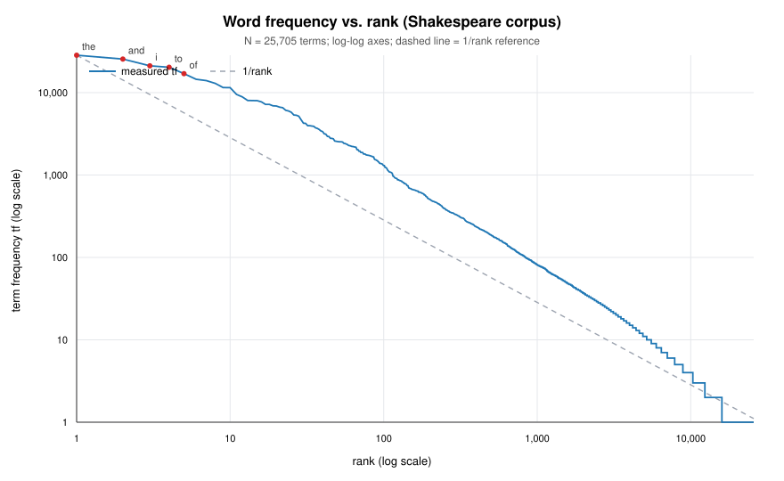
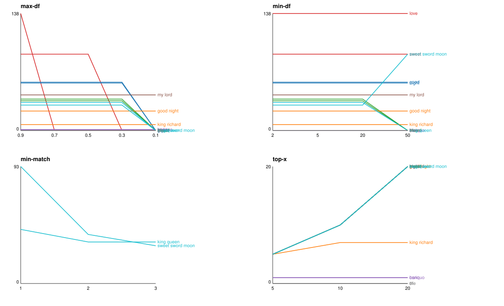
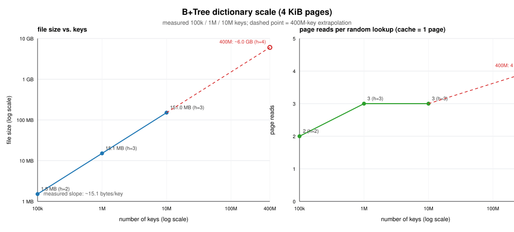

# 迷你搜索引擎项目报告

## 基于莎士比亚全集的带词干化倒排索引

> **草稿 v0.2**（2026-10-19）
>
> 说明：本文件为报告初稿。第 1–3 章、第 4 章主体以及 Bonus 的实做与实验均已完成；LaTeX 源（`report.tex`）与 PDF（`report.pdf`）已生成，剩余工作主要是匿名打包、按课程格式重命名与最终检查，见文末“待办”。

---

## 摘要

本项目在《莎士比亚全集》（The Complete Works of William Shakespeare）上实现了一个迷你搜索引擎。系统以 C++17 编写，提供词频统计、停用词推导、Porter 词干化、倒排索引构建、索引持久化以及单词/短语/布尔查询能力。语料共 195 个文档、152,632 行、930,911 个空白分隔词；默认配置下切分出 866,626 个正文 token，词型 25,705 个。通过自有统计推导出 39 个停用词后，索引保留 556,866 个 token（去除 35.74%），词干化后词表降至 14,937 个词干，倒排索引含 117,704 条 posting、556,866 个位置，v1 二进制文件约 3.5 MB。

正确性方面，系统采用四层验证：Catch2 单元测试（46 个测试用例、85,155 条断言）、讲义四文档黄金样例、独立实现的 Python 对拍（词频 CSV 逐字节一致、全词表 brute-force 对拍 14,937 个词干全项一致），以及结构不变量检查。查询侧实现四个可调阈值，并用 15 条查询 × 4 个参数共 201 次测量量化了阈值对结果集的影响。

在 Bonus 部分，系统进一步实现了：熵驱动的停用词推导（长度归一化速率熵）、语料无关的 plain 文本格式与 RFC 第二语料、v2 差分 + 变长编码压缩（索引降至 v1 的 46.8%）、磁盘 B+Tree 词典 sidecar、SPIMI 式块式外部构建，以及 500,000 文件 / 20,000,000 token 的合成语料跑批与 50,000,000 键的 B+Tree 规模实测。这些结果共同回答了“500,000 个文件、400,000,000 个不同词”的问题：全内存设计不可行，但构建侧与查询侧都已具备可实测的扩展路径。

**关键词**：倒排索引；停用词；Porter 词干化；伸展树；B+Tree；SPIMI；索引压缩；查询阈值；莎士比亚语料

---

## 第 1 章 引言

### 1.1 项目背景与目标

本课程项目要求实现一个能对莎士比亚全集进行查询的迷你搜索引擎。题目包含四项任务：

1. 对语料做词频统计，并识别停用词（noisy words），说明“有趣的词”与“噪声词”之间的界线画在哪里；
2. 在语料上建立带词干化的倒排索引，且不包含第 (1) 步识别出的停用词；
3. 在倒排索引之上实现查询程序，接受单词或短语，返回包含该词的文档 ID；
4. 运行测试，展示查询阈值如何影响结果。

评分标准将编程分为词频统计（1 分）、索引生成（5 分）、查询处理（3 分），测试分为索引正确性（2 分）、查询阈值（2 分）与分析评论（3 分），另有 Bonus：若拥有 500,000 个文件与 400,000,000 个不同单词，程序是否仍能工作（+2 分）。文档部分要求第 1 章（1 分）、第 2 章（2 分）以及完整报告的整体风格（1 分）。

本报告对应上述要求组织为四章：第 1 章介绍语料与系统全貌；第 2 章给出数据结构与算法规格；第 3 章给出测试结果与实验数据；第 4 章给出分析、局限与 Bonus 讨论。

### 1.2 语料与规模

语料来自 MIT 的 Shakespeare 站点（<http://shakespeare.mit.edu/>）。为便于复现，项目使用该站点的官方 GitHub 镜像 `TheMITTech/shakespeare`，固定 commit `6b82db8`（完整哈希见参考文献），抓取日期 2026-10-10，共 1,211 个 HTML 文件。

文档集合严格以站点首页 `index.html` 的四栏分类为准，共 **195 个文档**：

- 37 部戏剧（每部取完整的 `full.html`）；
- 154 首十四行诗（每首一个独立页面）；
- 4 首长诗（*Venus and Adonis*、*The Rape of Lucrece*、*A Lover's Complaint*、*Funeral Elegy*）。

按首页顺序分配稳定的 docID（1–195）：喜剧 17 部、历史剧 10 部、悲剧 10 部、诗歌 158 篇。仓库中还保留了站点的大写旧目录（`Comedy/`、`History/`、`Tragedy/`）和 Moby 纯文本版本，但它们与首页没有链接关系，不参与建索引——这是“以站点自身索引为唯一权威”的清洗原则。

语料的规模统计如下（`mse stats`）：

| 指标 | 数值 |
|---|---:|
| 文档数 | 195 |
| 总行数 | 152,632 |
| 正文行 | 114,315 |
| 标题行 | 1,099 |
| 舞台指示行 | 6,251 |
| 说话人行 | 30,967 |
| 空白分隔词数 | 930,911 |
| 文本字节数 | 4,919,371 |

默认配置（只统计正文行）切分出 **866,626 个 token**，其中不同词型 **25,705** 个，hapax（只出现一次的词）**9,753** 个。需要说明的是，930,911 是文本层的空白分隔字段数，而 866,626 是经过分词规则（标点、数字、标记行过滤）后的 token 数，两者口径不同，不能直接比较。

#### 1.2.1 第二语料与语料无关性

题目只要求莎士比亚语料，但引擎本身不应依赖莎士比亚。Bonus 阶段新增了两项通用化能力：

- **manifest 可选第 8 列 `format`**：`marked`（默认，带 `[标题]` / `(舞台)` / `@说话人` 标记）或 `plain`（每行都是正文）。plain 语料不会被行标记规则误删括号内容。
- **`tools/import_corpus.py`**：把任意纯文本目录转换成自包含语料（`manifest.tsv` + 文本副本，docID 按文件名稳定分配）。

仓库中的 `data2/` 是第二套语料：RFC 1035（DNS）、RFC 5321（SMTP）、RFC 7231（HTTP 语义），3 个 plain 文档、9,946 行、75,250 token、4,328 个词型。第 3、4 章用它验证“零代码改动换语料”以及熵停用词规则的跨语料行为。

### 1.3 系统总体设计

系统采用三层可再生成的数据流：

```text
data/raw/*.html                     原始 HTML（1,211 个文件，固定 commit）
        │  tools/extract.py
        ▼
data/text/*.txt + data/manifest.tsv 行式文本层 + 文档表（195 个文档）
        │  mse build
        ▼
build/index.bin                     倒排索引二进制（可加载、可 dump）
```

C++ 程序只读取文本层，不接触 HTML；HTML 的解析、清洗与文档切分在 Python 预处理阶段一次性完成。这样每层都可以独立检查、独立重跑，任何统计数字都能从上一层重新生成。同一套 C++ 管线也直接支持 `data2/` 的 plain 语料（manifest 第 8 列），无需改动引擎代码。

CLI 程序 `mse` 提供九个子命令：

| 子命令 | 作用 | 对应任务 |
|---|---|---|
| `stats` | 语料统计 | 前置/对拍 |
| `tokenize` | 查看 token 流 | 调试/实验 |
| `count` | 词频 tf/df/熵统计，输出 CSV | Task 1 |
| `stopwords` | 熵驱动的三特征停用词推导 | Bonus |
| `build` | 构建并序列化倒排索引（v1/v2） | Task 2 |
| `build-blocks` | SPIMI 式块式外部构建 | Bonus |
| `bptree-bench` | B+Tree 规模实测 | Bonus |
| `dump` | 打印 posting；支持磁盘词典 | 调试/报告 |
| `query` | 单词、短语、布尔查询与阈值 | Task 3/4 |

模块划分与代码组织如下：

| 模块 | 职责 |
|---|---|
| `corpus` | 读 manifest、读文本层（marked/plain）、解析行标记 |
| `tokenizer` | 切词、小写化、位置编号 |
| `stopwords` | 加载停用词表，O(1) 查询 |
| `stemmer` | Porter 词干化与收缩词预处理 |
| `posting` | posting 与 positions 的动态数组 |
| `dict` | 伸展树（主）+ 哈希（基线）+ `std::map`（对照） |
| `index` | 构建、v1/v2 序列化、加载、不变量、dump、懒加载 |
| `bptree` | 页式 B+Tree（内存构建 + 磁盘页文件 + LRU 读取） |
| `blockbuild` | SPIMI 两阶段（块内索引 → run 文件 → k 路归并） |
| `query` | 三种查询模式与四个阈值 |
| `count` | tf/df/熵统计、停用词规则、CSV 输出 |
| `main` | CLI 解析与子命令分发 |

### 1.4 完成情况

截至 2026-10-19：

| 评分项 | 状态 | 说明 |
|---|---|---|
| 词频统计程序（1 分） | ✅ | `mse count`，四种变体均与独立 Python 实现逐字节一致；新增熵特征列 |
| 索引生成程序（5 分） | ✅ | `mse build`，splay/hash/map 输出逐字节一致，v1/v2 两种格式均通过 brute-force 对拍 |
| 查询程序（3 分） | ✅ | 单词/短语/布尔、四阈值、`--pretty`、`--json`、磁盘词典路径 |
| 索引正确性测试（2 分） | ✅ | 8 个测试可执行文件、46 个 TEST_CASE、85,155 条断言；黄金样例 + 全量对拍 |
| 查询阈值测试（2 分） | ✅ | 201 条测量的阈值矩阵 |
| 分析评论（3 分） | ✅ | 见第 3、4 章，含 Bonus 实测与分析 |
| Bonus（+2 分） | ✅ | 熵停用词、RFC 第二语料、v2 压缩、B+Tree 磁盘词典、SPIMI 块式构建、500k 文件跑批、5000 万键规模实测；见 4.7 |
| 文档（4 分） | 🚧 进行中 | LaTeX 源与 PDF 已生成；剩余匿名检查与按课程格式重命名 |

### 1.5 报告组织

第 2 章给出各模块的规格、数据结构选择与算法伪代码；第 3 章给出测试策略、测试结果与实验数据；第 4 章讨论停用词界线（含熵规则）、Zipf 分布、词典对比、压缩实现、阈值语义、局限性以及 Bonus 的构建/查询两侧规模分析；附录给出构建命令、数据格式与评分对照表。

---

## 第 2 章 数据结构与算法规格

### 2.1 分层架构与模块边界

系统遵循“一个阶段只做一件事”的原则。分词器（`tokenizer`）只负责把文本变成规范化 token，既不移除停用词也不做词干化；停用词过滤（`stopwords`）与词干化（`stemmer`）是独立阶段；计数（`count`）、建索引（`index`）和查询（`query`）共用同一条规范化管线。这样任何一个数字出错，都能定位到唯一阶段，而不是在一条混合管线里猜测。

建索引与查询必须使用完全一致的规范化规则。索引文件头部记录了两个标志位：

```cpp
constexpr std::uint32_t kIndexFlagStopWords = 1u << 0;
constexpr std::uint32_t kIndexFlagStemmed   = 1u << 1;
```

查询程序读取索引头，按标志位决定是否过滤停用词、是否调用 Porter 词干化。这避免了“建索引时词干化、查询时未词干化”导致查空的一类常见错误。

### 2.2 语料获取与预处理

#### 2.2.1 原始语料与文档集合

`tools/fetch_corpus.sh` 通过 `git clone --depth 1` 获取镜像，并用 `git archive` 导出到 `data/raw/`，同时把仓库地址、commit、抓取日期和 HTML 文件数写入 `data/raw/SOURCE.txt`。抓取是一次性的，之后所有实验都可离线复现。

文档集合由 `tools/extract.py` 从首页解析得到：戏剧取 `full.html`，十四行诗按 `sonnet.<roman>.html` 的罗马数字顺序展开（并校验恰好 154 首），长诗取各自的页面。docID 按首页出现顺序分配，从 1 开始连续编号，`Corpus::load` 会校验编号必须是 `1..N` 的稠密序列。

#### 2.2.2 行式文本层

每个文档被转换为一个 `data/text/<docid>_<slug>.txt`，一行一个单元，行首标记区分类型：

| 标记 | 含义 | 默认是否参与检索 |
|---|---|---|
| `[ACT I]` / `[SCENE I. ...]` | 标题行（H1–H3） | 否（`--keep-headings` 可开） |
| `(Exit Ghost)` | 舞台指示（`<i>` 及从诗句拆出的方括号提示） | 否（`--keep-stage` 可开） |
| `@BERNARDO` | 说话人标签（`<b>`） | 否（`--keep-speakers` 可开） |
| 其他 | 台词、诗行、散文正文 | 是 |
| `#` 开头 | 文件头注释（docID、标题、来源、URL） | 跳过 |

manifest 的可选第 8 列 `format` 决定按哪种方式解释文本：`marked`（默认）使用上表；`plain` 跳过标记分类，所有非 `#` 行都是正文，适合 RFC、散文、日志等普通文本。plain 文档不会因为一行恰好以括号/方括号开头而被误判为舞台或标题。

行标记的判定规则是“行首与行尾同时匹配”：只有当一行以 `[` 开头且以 `]` 结尾时才视为标题行，以 `(` 开头且以 `)` 结尾时才视为舞台行。这条规则在开发中被证明非常关键：语料里存在大量“以 `[` 开头、但其实是台词”的行，例如 `[To HELENA] The best wishes that can be forged in`；如果只按行首判断，会损失 4,340 个 token。对拍脚本最初就踩了这个坑，修正后 C++ 与 Python 才重新一致。

#### 2.2.3 清洗中的边界情况

预处理阶段处理了若干源数据问题，均有测试记录：

- `elegy.html` 的 `</TITLE` 缺少 `>`，导致 HTMLParser 永远不发出 `</head>`；提取器把 `<body>` 的开始作为“头部结束”的兜底信号。
- `elegy` 的诗文藏在表格中，每 5 行有一个纯数字行号单元格；提取器只丢弃导航表格（`td.play` / `td.nav`）和纯数字单元格，保留诗文表格。
- Moby 版把内嵌舞台提示写成方括号，共 610 处。提取器把行首的 `[...]` 片段重定位为独立舞台行 `(...)`，避免 `aside`、`sings`、收信人名混入正文词表。修复后正文 token 从 867,475 降到 866,626，净减 849，与 B 类片段的统计完全吻合。
- `2henryiv` 中有 `<h3>None</h3>` 转换残渣；提取器丢弃它，不臆造 `ACT I`。
- 全语料非 ASCII 字符数为 0（撇号统一为 `'`，破折号为 `--`），因此 tokenizer 可按字节处理，不需要 Unicode 归一化。这一前提在报告中明确记录；换语料时必须重新检查。

### 2.3 分词与规范化

`tokenizer` 的规则如下（`plan.md §3.4`）：

- token 是连续的 ASCII 字母；数字、连字符、标点都是分隔符：`to-day` → `to`、`day`；
- 撇号只保留在 token 内部（两个字母之间）：`don't` → `don't`，`'Tis` → `tis`，`friends'` → `friends`；
- 所有 token 小写化：`KING.` → `king`；
- 分词器不删除停用词、不做词干化；
- 每个文档内 position 从 0 开始递增，记录在 posting 中。

边界用例包括撇号（内部、行首、行尾、连续）、连字符、数字（`1660s` → `s` 是已知边缘行为）、纯标点、空输入、全大写。

### 2.4 任务 (1)：词频统计与停用词判定

#### 2.4.1 tf 与 df 的定义

对每个规范化后的词项 `t`：

- **tf(t)**：`t` 在全部文档中的总出现次数；
- **df(t)**：包含 `t` 至少一次的文档数；
- **df_ratio(t) = df(t) / 文档总数**；
- **tf_share(t) = tf(t) / 总 token 数**。

`countWords()` 按文档遍历。为了在 O(1) 时间内更新 df，每个词项记录 `lastDoc`：只有当前文档 ID 与 `lastDoc` 不同时才把 df 加一。词干化阶段使用缓存，相同的词形只调用一次 `stem()`。

`mse count` 输出 CSV 列：`rank, term, tf, df, df_ratio, tf_share, stop_candidate`。其中 `stop_candidate` 是**粗筛标记**，规则为 `df_ratio ≥ 0.75 且 tf_share ≥ 0.1%`；它只是给人工分析提供候选，不是最终停用词表。

#### 2.4.2 候选带的确定

如果直接用 0.75 的粗筛线，只能得到 9 个词（`the and i to of my that in but`）。这条线过于保守：154 首短诗会显著稀释 df——很多功能词只出现在戏剧对白中，而短诗里没有，因此 df_ratio 被拉低。为了不漏掉结构性功能词，最终分析把候选带放宽到：

```text
tf_share ≥ 0.1%（≥ 867 次）
且 df_ratio ≥ 0.40（≥ 78/195 篇）
```

得到 **48 个候选词**。这条规则的两个条件分工明确：`df_ratio` 管“广度”（词是否遍布整个语料），`tf_share` 管“强度”（词是否足够高频）。在本语料上，df 条件是决定性条件：只按 df_ratio ≥ 0.75 筛出 9 个词；只按 tf_share ≥ 0.1% 筛出 125 个词；两者的交集仍是这 9 个词。tf_share 条件作为通用护栏保留，防止在超大语料上仅凭 df 选入过于罕见的词。

阈值敏感性如下（`tf_share ≥ 0.1%` 固定，逐步放宽 df 线）：

| df_ratio 阈值 | 候选数 | 相对上一档新增的词 |
|---:|---:|---|
| ≥ 0.90 | 4 | the and to in |
| ≥ 0.75 | 9 | + i of my that but |
| ≥ 0.70 | 14 | + a is not for with |
| ≥ 0.65 | 16 | + so love |
| ≥ 0.60 | 21 | + me be thou thy thee |
| ≥ 0.50 | 31 | + it this as by all do on from which when |
| ≥ 0.40 | 48 | + his have what no if are o or more then their hath than yet mine time doth |

这张表就是“线画在哪里”的直接依据：阈值每放宽一档，新增词从明显的高频功能词逐渐过渡到内容词和古语词，0.40 之后新增项已经开始包含 `love`、`time` 这类有检索价值的词，因此把界线定在 0.40。

#### 2.4.3 从候选到最终停用词表

对 48 个候选词做人工边界判定，只保留**结构性功能词**：冠词、介词、连词、代词、助动词、wh-词。最终得到 **39 个词**，写入 `data/stopwords.txt`。判定中刻意排除两类词：

- **内容词**：`love`（tf 2,224 / df 127，df_ratio 65.1%）、`time`（df_ratio 40.0%）——它们在文学检索中恰恰是有意义的查询词；
- **古语功能词**：`thou thee thy hath doth o mine`——它们在莎士比亚文体中有区分度，留作“激进版”对照。

线下方但保持可检索的代表词：`you`（38.5%）、`he`（33.3%）、`we`（26.7%）。它们的 df 被短诗稀释，是文档粒度效应的直接证据。

39 词停用表覆盖正文 **309,760 / 866,626 = 35.74%** 的 token；过滤后保留 556,866 个 token，词型从 25,705 降到 25,666（不词干化时）。报告第 3.5 节给出完整结果，第 4.1 节讨论这条线的合理性。

#### 2.4.4 熵驱动的三特征规则（Bonus）

静态 39 词表依赖人工审核。为了在任意语料上自动完成这一步，`mse count` 增加了三个分布特征，并实现 `mse stopwords --derive`。

设文档 `d` 中词 `t` 的 tf 为 `tf(t,d)`，总 tf 为 `tf(t)`，文档长度为 `L_d`（过滤后 token 数）：

- 文档分布熵：`H(t) = -Σ_d p_d log2 p_d`，其中 `p_d = tf(t,d) / tf(t)`；
- 归一化熵：`entropyNorm = H(t) / log2(df)`；
- 长度归一化速率熵：`rate_d = tf(t,d) / L_d`，`q_d = rate_d / Σ rate`，`entropyRateNorm = -Σ_d q_d log2 q_d / log2(df)`。

**为什么必须做长度归一化**：本语料中一部剧约 3 万 token，一首十四行诗约 100 token，长度差约 300 倍。停用词的出现次数跟随文档长度（长文多、短文少），所以原始 `H` 反映的是“文档长度分布”，而不是“均匀分布”。实测 `the` 的 `entropyNorm` 只有 **0.724**，反而低于内容词 `man` 的 **0.941**——直接使用原始熵会把停用词排到内容词后面。改用速率熵后，功能词普遍落在 0.95–0.98（`the` 0.975、`and` 0.979、`it` 0.969、`is` 0.972），内容词明显更低（`love` 0.927、`sweet` 0.893、`king` 0.826、`heart` 0.831），df=1 的专名（如 `osric`）定义为 0。

三特征规则要求词同时“宽”（`df_ratio ≥ r`）、“重”（`tf_share ≥ s`）、“平”（`entropyRateNorm ≥ h`）。`mse stopwords --derive` 的默认阈值是 `(0.75, 0.1%, 0.93)`，可分别用 `--min-df-ratio / --min-tf-share / --min-entropy-rate` 覆盖。阈值扫描（对照静态 39 词表）：

| df 门 | 熵门 | 词数 | 与静态表重叠 | 说明 |
|---:|---:|---:|---:|---|
| 0.75 | 0.93 | 9 | 9/9 | 默认，保守，零误报 |
| 0.50 | 0.95 | 23 | 23/23 | 仍零误报 |
| 0.40 | 0.93 | 39 | 35/39 | **自动复现人工定稿的规模** |
| 0.30 | 0.93 | 50 | 35/39 | 开始收进半功能词，过冲 |

(0.40, 0.93) 的 39 词与人工表恰好互换 4 词：自动版加入 `hath o thee thou`（正是 2.4.3 节刻意保留可检索的古语功能词），漏掉 `more or than their`。差异完全可解释，没有离群误报——熵特征实质上完成了人工审核的工作。三套索引的规模对比见 3.5 节。

### 2.5 词干化

#### 2.5.1 收缩词预处理

分词后的 token 可能带内部撇号（`who's`、`o'er`、`marry'd`）。词干化前先做收缩词规范化：

1. 按最长优先剥离一个收缩后缀：`n't`、`'ll`、`'re`、`'ve`、`'s`、`'d`、`'t`、`'m`；
2. 去掉剩余的所有撇号（省略式，如 `o'er` → `oer`）。

文档化的不规则结果：`can't → ca`、`won't → wo`（`n't` 整段剥离遇到英语不规则拼写）；`was → wa`、`this → thi` 是 Porter 论文 step 1a 中无条件的 `S` 规则造成的，保留为论文行为。

#### 2.5.2 Porter 算法

实现严格按 Porter 1980 的规则表：step 1a（复数）、1b（`-ed` / `-ing`）、1c（词尾 `y`）、step 2（双后缀映射）、step 3（`-icate` / `-ative` / `-alize` 等）、step 4（残余后缀）、step 5a（词尾 `e`）、step 5b（双 `l`）。

核心概念是 measure `m`：单词中“元音-辅音”对（VC）的个数。元音定义为 `a e i o u`，以及前面是辅音的 `y`。规则的条件用 `m`、`*v*`（词干含元音）、`*d`（双辅音结尾）、`*o`（cvc 且最后字母不是 `w/x/y`）表达。

一个容易实现错的细节是后缀匹配的“首个匹配说了算”：规则表按后缀长度从长到短排列；一旦某个后缀匹配，就只检查该规则的条件，条件失败**不再**尝试更短的后缀。例如 `agreement` 匹配 `ement`，条件在 `agre` 上不满足，于是保持不变，而不是退回去匹配 `ment`。最初的实现写成“条件失败继续试更短后缀”，导致 41 个词形被过度词干化（例如 `agreem`），后来由全词表对拍抓出并修正。

#### 2.5.3 变体选择

实现采用“论文 + 作者 canonical C 实现中三处 `--DEPARTURE--`”的语义，等价于 NLTK 的 `MARTIN_EXTENSIONS`：

1. 两个字母及以下的词不改（长度护栏）；
2. `bli → ble`（推广论文的 `abli → able`，如 `possibli → possibl`）；
3. `logi → log`（如 `chronologi → chronolog`）。

选择理由：作者本人推荐这些改进；`is → i` 一类合并过于激进；且与下载的 canonical C 实现一致。NLTK 的 `MARTIN_EXTENSIONS` 模式作为独立 oracle，用于全词表对拍。

规范化顺序在全链路统一为：**小写化 → 停用词过滤 → 词干化**（先滤后干）。这样停用词判断针对原始词形，词干化只作用于保留下来的词。

### 2.6 倒排索引

#### 2.6.1 posting 结构

对每个词干 `t`，保存一个按 docID 严格递增的 posting 列表：

```text
t → [ { docID: u32, posStart: u32, tf: u32 } ... ]
      + positions: u32[]（所有文档的位置连续存放，按 posStart/tf 切片）
```

- `docID` 从 1 开始，严格递增；
- `posStart` 是该文档在 `positions` 数组中的起始下标；
- `tf` 是该文档内的出现次数；
- `positions` 是 token 在**过滤后 token 流**中的偏移（停用词不占位置），用于短语匹配。

将 positions 放在独立的 arena 中，而不是每个 posting 各带一个 `vector`，可以减少小对象和内存分配次数，也让序列化更直接。

#### 2.6.2 词典结构：伸展树、哈希表与 std::map

系统定义了统一的 `Dictionary` 接口：

```cpp
virtual TermEntry& upsert(const std::string& term) = 0;  // 查找或插入
virtual TermEntry* find(const std::string& term) = 0;    // 只查找
virtual std::vector<TermEntry*> sortedEntries() = 0;     // 字典序输出
```

三个实现：

**伸展树（主结构）**：自调整二叉搜索树。每次查找/插入后把访问节点通过 zig / zig-zig / zig-zag 旋转到根。支持的操作是“只插入、不删除”；词流呈 Zipf 分布，高频词会停留在根附近；中序遍历直接得到字典序词表，正好用于冻结 term 表。构建期统计字符串比较次数与旋转次数。

**哈希表（基线/互验）**：链地址法，FNV-1a 64 位哈希，负载因子超过 0.75 时翻倍 rehash。平均 O(1) 查找，但输出有序词表需要额外收集与排序。它与伸展树走完全相同的构建管线，产出的索引文件必须逐字节一致——这是独立于 Python 对拍的另一层互验。

**std::map（标准库对照）**：`std::map<std::string, TermEntry>`，典型实现是红黑树。由于 `std::map` 的内部比较不可观测，`MapDictionary` 用一个带计数的严格弱序比较器包住它，使三者的“字符串比较次数”是同一口径的机器无关指标。它是 plan.md §6.5 预留的第三列实验。

选择伸展树作为主结构的理由：本场景“只插不删”，红黑树最复杂的删除情形不存在；访问高度偏斜，splay 的自调整能利用热点；最终需要字典序输出，中序遍历免费排序。哈希表保留为速度基线与交叉验证，`std::map` 作为标准库对照点。三者的产出必须逐字节一致。

#### 2.6.3 构建算法

```text
for each doc D in manifest:                 // docID 递增
    position ← 0
    for token t in tokenize(D):             // 默认只统计正文行
        if t ∈ stopwords: continue          // 停用词不占 position
        s ← stem(t)
        dictionary.upsert(s).postings.append(D.id, position)
        position ← position + 1
    index.docs.append(D.id, title, position)
    index.tokenCount ← index.tokenCount + position

terms ← dictionary.sortedEntries()           // 伸展树中序 / 哈希收集后排序
serialize(index) → index.bin
```

构建期同时统计 token 总数、不同词干数、posting 数、position 数、索引文件大小与构建耗时。

#### 2.6.4 持久化格式（v1 与 v2）

索引文件为小端、自描述、确定性序列化。v1：

```text
[header]
  magic        "MSE1"       4 B
  version      u32          4 B   （1 = v1；2 = v2 压缩）
  flags        u32          4 B   （bit0=停用词，bit1=词干化）
  docCount     u32          4 B
  termCount    u32          4 B
  tokenCount   u64          8 B

[doc 表]   每项：docID u32, keptTokens u32, title（u32 长度 + 字节）
[term 表]  按字典序，每项：
             term（u32 长度 + 字节）
             df u32
             tf u64
             postingsOffset u64
             postingsBytes u32
[postings] 每个 term：
             df 条 { docID u32, tf u32, positions u32[tf] }
```

写入前先计算所有 offset，顺序写出；读取时先读 term 表，再按 offset 跳转到各自的 postings 块。这样写入与读取共享同一份规格，`dump` 可以验证往返一致性。

v2 只改变 `[postings]` 段的编码，头部、文档表、term 表布局完全不变，靠 `version = 2` 区分。每个 posting 块依次编码：

- `docID` 差分（相邻 docID 的 gap，≥ 1）；
- `tf`；
- 文档内 positions 的相邻差分（≥ 0）。

所有整数使用字节对齐变长码：首字节高 2 位表示总长度（1–4 字节），低 6 位是数值低位，后续字节各贡献 8 位；可表示 6/14/22/30 位，最大值受 30 位限制。v2 的 term 表 offset/length 指向压缩后的块，读取端按版本选择解码器。实现与结果见 4.4 节。

#### 2.6.5 不变量

`validateIndex()` 在加载后检查以下不变量，任一违反即抛出异常：

- docID 稠密且为 `1..N`；
- term 表严格字典序递增，且无空词；
- 每个 term 的 posting 非空；
- posting 内 docID 严格递增且不超过文档数；
- 每条 posting 的 `tf > 0`，且 `posStart` 连续（dense）；
- 每个 term 的 `tf` 之和等于其 positions 数组长度；
- 所有 term 的 position 总数等于 `tokenCount`；
- 所有文档的 `keptTokens` 之和等于 `tokenCount`。

#### 2.6.6 磁盘 B+Tree 词典（Bonus）

索引的 term 表在 400M 词规模下无法常驻内存。`build --dict-file` 在写索引的同时，把 `term → (posting offset, byte length)` 冻结成一个页式 B+Tree 文件（sidecar）：

- 每个节点是一个有字节预算的页（默认 4096 B）；键是变长 term，节点按“是否还装得下下一条”分裂；
- 叶节点用 `nextLeaf` 串成有序链，支持范围/前缀扫描；
- 文件头页记录 magic `BPT1`、版本、页大小、页数、根、树高、叶数、键数；
- 值把 posting 偏移和长度打包成一个 u64：`(offset << 21) | length`，因此单 term posting 最长 2 MiB，offset 可达 2^43 字节；
- `BTreeFile` 读取端只加载根路径上的 O(height) 个页，并用 LRU 缓存（默认 8 页）减少重复读。

不变量 I1–I5：节点内键严格递增；内部路由区间左闭（分隔键是真实键的副本）；非根节点满足变长键下可证的填充下界；所有叶同深且叶链按序覆盖全部键；每个键只有一个值。`BTree::validate()` 全量校验。

查询侧 `LazyIndexReader` 只解析索引头和文档表，term 经 B+Tree 定位后直接 seek 到 posting 字节，词表与 postings 都不整体加载。实测见 3.6/3.7 节。

#### 2.6.7 块式外部构建（SPIMI，Bonus）

`build-blocks` 实现两阶段构建：

1. **块内索引**：按文档流扫描，块内词典达到 `--block-terms` 预算（默认 4096）就冻结：按词排序写入临时 run 文件，然后清空词典继续；
2. **k 路归并**：把所有 run 当成有序词流，按词归并成最终索引。

因为块边界只切在文档边界，同一个词在后续块中的 posting 的 docID 一定更大，归并时只需按词拼接，位置编号也是文档内独立编号。内存占用 O(blockTerms)，与语料总词表大小无关；产物与 `buildIndex()` 逐字节一致。实测见 3.6 节。

### 2.7 查询处理

#### 2.7.1 查询管线

查询文本先用与语料相同的 tokenizer 切分，再按索引头标志位执行停用词过滤与词干化：

```text
query text → tokenize → [stop word check] → [stem] → terms
           → 词典二分查找 → posting 合并/位置验证 → 评分 → 阈值过滤 → 输出
```

词典查找使用冻结 term 表上的二分搜索，复杂度 O(log #terms)。给出 `--dict-file` 时，单词查询改走磁盘 B+Tree：按树高 O(height) 次页读定位 term，再 seek 到 posting 字节；评分、阈值与输出仍复用同一个 `runQuery()`。

#### 2.7.2 三种查询模式

**单词（Word）**：要求恰好一个可检索 term；多个 token 会给出提示并返回空集。结果按“匹配词数降序、Σtf 降序、docID 升序”排序。

**短语（Phrase）**：把短语切成词序列 `w1..wk`，要求所有词都在索引中；选取 df 最小的词作为候选文档，对每个候选文档做位置验证：`pos(w_{i+1}) = pos(w_i) + 1`。由于 positions 在 posting 内按升序存放，验证使用二分查找。短语查询不受 `--max-df` / `--min-df` 裁词影响——短语的语义要求整段匹配，丢掉任何一个词都会改变语义。

**布尔（Boolean）**：`--words "a b c"` 指定多个词，默认要求全部命中（AND）；`--min-match k` 表示至少命中 k 个词；`--or` 是 `--min-match 1` 的简写。被管线或阈值丢弃的词不参与匹配，输出用 `note:` 行说明原因。

#### 2.7.3 评分与四个阈值

| 参数 | 含义 | 默认 |
|---|---|---|
| `--max-df <ratio>` | 丢弃 `df_ratio > ratio` 的查询词（太常见、区分度低） | 1.0（关闭） |
| `--min-df <n>` | 丢弃 `df < n` 的查询词（太罕见） | 1（关闭） |
| `--min-match <k>` | 布尔查询至少命中 k 个词；0 = 全部命中 | 0 |
| `--top-x <n>` | 只保留得分最高的 n 篇文档 | 0（不限） |

评分向量为 `(matched, tfSum, docID)`，排序规则为 matched 降序 → tfSum 降序 → docID 升序，保证结果确定性。`minMatch` 会被钳制到可用词数：如果查询只有 2 个可检索词，`--min-match 3` 等价于 2。

#### 2.7.4 输出

默认输出 `docID<TAB>标题`，多词查询附带 `[matched k/n, tf ...]`；`--pretty` 会重跑同一管线，把命中 position 映射回源行并打印；`--json` 输出机器可读结果，供阈值实验脚本消费。命中位置的映射函数 `lineOfPosition()` 只遍历 `LineKind::Body` 行，并对停用词跳过位置计数，因此与建索引时的 position 语义一致。

### 2.8 复杂度汇总

| 操作 | 时间复杂度 | 空间 |
|---|---|---|
| 分词 | O(字符数) | O(token 数) |
| 词频统计 | O(token 数)，哈希平均 O(1)/词 | O(distinct 词数) |
| 建索引（splay） | 摊还 O(log #terms)/次访问 | O(postings + positions) |
| 建索引（hash） | 平均 O(1)/次访问 | O(postings + positions) |
| 建索引（std::map） | O(log #terms)/次访问 | O(postings + positions) |
| 块式构建（SPIMI） | O(token 数 + 归并量) | **O(blockTerms)** |
| 单词查询（内存表） | O(log #terms + df) | O(#docs) |
| 单词查询（磁盘 B+Tree） | O(height) 页读 + O(df) 解码 | O(cachePages) + O(df) |
| 短语查询 | O(df_rarest × k × log tf) | O(#docs + k) |
| 布尔查询 | O(Σ df_i + #docs log #docs) | O(#docs) |
| v2 posting 解码 | O(压缩块字节数) | O(df + tf) |

---

## 第 3 章 测试与结果

### 3.1 测试策略

测试分为四层，覆盖“规格是否正确”和“实现是否忠实于规格”两个问题：

1. **单元测试**：Catch2 v3（vendored，仅测试可执行文件链接），覆盖 tokenizer、stemmer、dict、index、query、stopwords、count、bptree；
2. **黄金样例**：讲义中的四文档例子，逐项比对 posting 表；
3. **独立对拍**：用 Python 独立实现同一规格，与 C++ 输出逐字节或逐项比较；
4. **不变量与边界**：索引加载校验、损坏文件、空查询、停用词查询、未知词、B+Tree 与 `std::map` oracle 对拍等。

`ctest` 注册了 8 个单元测试可执行文件，外加 `mse_stats` / `rfc_stats` 冒烟测试、v1/v2 的 brute-force 与磁盘词典对拍，以及 v1/v2 的短语级对拍，共 **18 项**（Python 可选；未安装时跳过）。

### 3.2 单元测试结果

本次在 WSL2 + g++ 15.2（`-std=c++17 -O1`）下编译并运行八个测试可执行文件，全部通过：

| 测试文件 | TEST_CASE 数 | 断言数 | 结果 |
|---|---:|---:|---|
| `test_tokenizer` | 2 | 24 | 通过 |
| `test_stemmer` | 7 | 101 | 通过 |
| `test_dict` | 6 | 50 | 通过（新增 `std::map`） |
| `test_index` | 8 | 248 | 通过（新增 v2/压缩链） |
| `test_query` | 7 | 26 | 通过 |
| `test_stopwords` | 3 | 11 | 通过 |
| `test_count` | 3 | 47 | 通过（熵特征与派生规则） |
| `test_bptree` | 10 | 84,648 | 通过（`std::map` oracle + 文件往返） |
| **合计** | **46** | **85,155** | **全部通过** |

`test_bptree` 的 8.4 万条断言主要来自“对每个键与 `std::map` oracle 逐项比较”的三档页宽/对抗性键测试；断言数大不代表用例多，而是每个键的读/写/范围扫描都被显式核对。

此外，`mse stats` 冒烟测试确认语料仍为 195 个文档；`crosscheck_brute_force` 对全词表对拍通过（见 3.4）。

### 3.3 黄金样例：讲义四文档

`tests/fixtures/golden4/` 复刻了讲义 §1.2 的四文档例子：

| docID | 文本 |
|---:|---|
| 1 | Gold silver truck |
| 2 | Shipment of gold damaged in a fire |
| 3 | Delivery of silver arrived in a silver truck |
| 4 | Shipment of gold arrived in a truck |

原始构建（无停用词、无词干化）得到 4 个文档、11 个词、25 个 token。逐项比对结果：

| 词 | posting（docID, tf） |
|---|---|
| a | (2,1) (3,1) (4,1) |
| arrived | (3,1) (4,1) |
| damaged | (2,1) |
| delivery | (3,1) |
| fire | (2,1) |
| gold | (1,1) (2,1) (4,1) |
| in | (2,1) (3,1) (4,1) |
| of | (2,1) (3,1) (4,1) |
| shipment | (2,1) (4,1) |
| silver | (1,1) (3,2) |
| truck | (1,1) (3,1) (4,1) |

位置校验：doc1 中 `silver` 在 position 1；doc3 中 `silver` 在 positions 2 和 6。

**一处参考材料复核**：讲义表格把 `a` 记为 (2,1)(4,1)，但示例句子中 doc3 的原文是 “Delivery of silver arrived in **a** silver truck”，按句子重算应为 (2,1)(3,1)(4,1)。项目以句子为建索引的事实依据，测试中显式记录了这一差异。这一点也说明：引用示例时应以原始文本为准，而不是以二手表格为准。

停用词版本（过滤 `a/of/in`）得到 8 个词；`silver` 在 doc3 中的位置重新编号为 1 和 3，验证了“停用词不占 position”的语义。

### 3.4 独立对拍

对拍的价值在于：如果 C++ 与 Python 两边都错，只有“同错”才会通过；因此规格中的每个模糊点都必须在两边独立写成一致的行为。本项目的对拍结果如下：

| 对拍项 | 规模 | 结果 |
|---|---|---|
| 逐文档 token 数（C++ tokenizer vs Python） | 195 文档 | 100% 一致，866,626 token |
| `wordcount.csv` 默认配置 | 25,705 行 | 逐字节一致 |
| `wordcount.csv --keep-speakers` | 25,705 行 | 逐字节一致 |
| `wordcount.csv --stop-words` | 556,866 kept / 309,760 removed | 逐字节一致 |
| `wordcount.csv --stem` | 14,947 词干 | 逐字节一致（NLTK `MARTIN_EXTENSIONS`） |
| `wordcount.csv --stem --stop-words` | 14,937 词干 | 逐字节一致 |
| 词典层随机工作负载 | 20,000 次操作 / 300 词 | splay 与 hash 词表完全一致 |
| 索引文件（splay vs hash） | 3,685,655 B | **逐字节一致** |
| 索引文件（splay vs std::map） | 3,685,655 B | **逐字节一致** |
| `brute_force.py` 全词表对拍（v1） | 14,937 词干 | df、tf、docID、positions 全项一致 |
| `brute_force.py` 全词表对拍（v2 压缩） | 14,937 词干 | 独立解析 v2 文件，全项一致 |
| `brute_force.py` raw 版 | 25,705 词 | 全项一致（见 notes.md 记录） |
| 块式构建 vs 内存构建 | 17 个 run / 4,166,556 B 临时 | **索引逐字节一致** |
| 磁盘 B+Tree `dump --verify-all` | 14,937 词 | 逐词 posting 与全量加载 0 差异 |
| 磁盘词典查询 vs 全量加载 | `osric` 单词查询 | 文本与 JSON 输出逐字节一致 |
| 短语查询 vs 独立扫描（v1） | 303 条随机短语 | 返回文档集 100% 一致 |
| 短语查询 vs 独立扫描（v2） | 303 条随机短语 | 返回文档集 100% 一致 |
| RFC 语料（`data2/`）全链路 | 3 文档 / 2,660 词干 | count CSV 逐字节一致；brute-force 全项一致 |

`brute_force.py` 是独立实现的第二套索引路径：它重新扫描 `data/text/`，用独立的 tokenizer/停用词表/NLTK Porter 重建 posting，同时用独立的二进制解析器读取 `index.bin`，然后逐词比较。它不是“调用 C++ 的结果再比较”，而是真正从原始数据重建期望值。

### 3.5 任务 (1) 结果：词频与停用词

默认配置（只统计正文行）的统计结果：

```text
documents: 195
tokens   : 866,626
distinct : 25,705
hapax    : 9,753 (tf = 1)
```

top 10 词项：

| rank | term | tf | df | df_ratio | tf_share |
|---:|---|---:|---:|---:|---:|
| 1 | the | 28,436 | 177 | 90.8% | 3.28% |
| 2 | and | 25,553 | 189 | 96.9% | 2.95% |
| 3 | i | 21,131 | 154 | 79.0% | 2.44% |
| 4 | to | 20,302 | 187 | 95.9% | 2.34% |
| 5 | of | 16,976 | 175 | 89.7% | 1.96% |
| 6 | a | 14,527 | 138 | 70.8% | 1.68% |
| 7 | you | 13,998 | 75 | 38.5% | 1.62% |
| 8 | my | 12,934 | 159 | 81.5% | 1.49% |
| 9 | that | 11,513 | 172 | 88.2% | 1.33% |
| 10 | in | 11,479 | 181 | 92.8% | 1.32% |



*图 3-1：莎士比亚语料的 Zipf 分布。横轴为词频排名，纵轴为 tf；虚线为 1/rank 参考线。少量高频词占据大部分 token，长尾由大量 hapax 组成。*

stop_candidate 粗筛（`df_ratio ≥ 0.75 且 tf_share ≥ 0.1%`）得到 9 个词：`the and i to of my that in but`。最终按 2.4.2 的 0.40 候选带 + 人工结构判定得到 39 词停用表，覆盖 35.74% 的 token。

滤波前后对比：

| 配置 | token 数 | distinct | hapax | 说明 |
|---|---:|---:|---:|---|
| 不过滤 | 866,626 | 25,705 | 9,753 | 基线 |
| `--stop-words` | 556,866 | 25,666 | 9,753 | removed 309,760（35.74%） |
| `--stem` | 866,626 | 14,947 | 4,843 | 词干化合并词形 |
| `--stem --stop-words` | 556,866 | 14,937 | 4,846 | 正式索引配置 |

**熵特征与自动停用词（Bonus）**

`mse count` 新增 `entropy, entropy_norm, entropy_rate_norm` 三列。代表性读数：

| 词 | tf | df | entropy_norm | entropy_rate_norm | 类型 |
|---|---:|---:|---:|---:|---|
| the | 28,436 | 177 | 0.724 | 0.975 | 功能词 |
| and | 25,553 | 189 | 0.721 | 0.979 | 功能词 |
| it | 8,001 | 100 | 0.805 | 0.969 | 功能词 |
| is | 9,508 | 137 | 0.760 | 0.972 | 功能词 |
| love | 2,224 | 127 | 0.789 | 0.927 | 内容词 |
| sweet | 852 | 87 | 0.838 | 0.893 | 内容词 |
| king | 1,368 | 40 | 0.818 | 0.826 | 内容词 |
| heart | 1,086 | 70 | 0.894 | 0.831 | 内容词 |
| osric | 3 | 1 | 0 | 0 | 专名 |

原始熵排序反直觉（`the` 0.724 < `man` 0.941），长度归一化后功能词与内容词才分开。`mse stopwords --derive --min-df-ratio 0.4 --min-entropy-rate 0.93` 自动得到 39 词，与人工表重叠 35；差异见 2.4.4 节。

三套索引（均 `--stem`）：

| 停用词 | tokens | terms | postings | 索引字节 |
|---|---:|---:|---:|---:|
| 无 | 866,626 | 14,947 | 121,903 | 4,958,598 |
| 静态 39（`data/stopwords.txt`） | 556,866 | 14,937 | 117,704 | 3,685,655 |
| 动态 39（derive 0.4/0.001/0.93） | 552,096 | 14,936 | 117,631 | 3,665,959 |

动态表把 `thou` 等古语词判为停用词，因此 `--word thou` 在动态索引返回空 + note，在静态索引命中 123 篇；`love` 两边一致。动态索引已通过 brute-force 14,936 词全项对拍。这正是“线画在哪里”的另一种可执行答案：同一规则换阈值即可得到保守版或激进版。

### 3.6 任务 (2) 结果：索引构建

同一份语料、同一构建管线，四种配置的索引规模：

| 配置 | terms | postings | positions | 索引大小 |
|---|---:|---:|---:|---:|
| raw | 25,705 | 152,650 | 866,626 | 5,598,793 B |
| stopwords | 25,666 | 147,909 | 556,866 | 4,320,622 B |
| stem | 14,947 | 121,903 | 866,626 | 4,958,598 B |
| **stopwords + stem** | **14,937** | **117,704** | **556,866** | **3,685,655 B** |

观察：

- 停用词过滤主要减少 token 与 posting（-35.74% token），但词型只减少 39 个；
- 词干化主要减少词型（25,705 → 14,947，-41.9%），但 token 数不变；
- 两者叠加得到最小的索引：14,937 个词干、117,704 条 posting、556,866 个位置、3.5 MB；
- `stem` 单独使用时索引反而比 `stopwords` 单独使用更大（4.96 MB vs 4.32 MB），因为它保留了全部 866,626 个位置；这说明“词表小”不等于“索引小”，posting 与 positions 的体积同样重要。

词典对比实验（正式配置 = stopwords + stem）：

| 词典 | 构建耗时 | 字符串比较次数 | 比较次数/访问 | 旋转 / rehash | 索引输出 |
|---|---:|---:|---:|---:|---|
| 伸展树（主） | 0.35 s | 6,392,724 | ≈ 11.5 | 5,850,795 次旋转 | 3,685,655 B |
| 哈希（基线） | **0.18 s** | **688,494** | **≈ 1.24** | 11 次 rehash | **逐字节相同** |
| std::map（对照） | 0.29 s | 8,059,804 | ≈ 14.5 | —（内部不可观测） | **逐字节相同** |

说明：耗时是本机（WSL2, g++ 15.2, `-O2`）的测量，会随硬件变化；字符串比较次数、旋转次数与 rehash 次数是确定性指标，与硬件无关。

**压缩（v2）**：同一索引用 `--compress` 写出 v2，大小为 **1,725,694 B**，相对 v1 的 3,685,655 B 降至 **46.8%**；构建耗时从 0.35 s 增至 0.48 s（编码开销）。`brute_force.py` 独立解析 v2 文件，14,937 词全项一致；`dump --verify-all` 也 0 差异。

**磁盘 B+Tree 词典**：正式索引的 sidecar 为 **237,568 B**（58 页 × 4 KiB，高 2），占索引的 **6.4%**。冷查询 `banquo`：词典 2 页 + 索引 8,308 B ≈ 16.5 KB，是全量加载 3,685,655 B 的 **0.45%**；`--verify-all` 扫描 14,937 词，114 次页读 + 29,819 次缓存命中，0 差异。

**块式构建**：`--block-terms 4096` 在本语料上产生 **17 个 run**、峰值 5,129 个活词、临时 run 共 4,166,556 B；扫描 0.36 s + 归并 0.06 s，产物与内存构建**逐字节一致**。

### 3.7 任务 (3) 结果：查询

正式索引上的代表性查询：

| 查询 | 模式 | 结果 | 说明 |
|---|---|---:|---|
| `osric` | word | 1 篇（Hamlet, doc 30） | tf=3，positions 17629/17933/18173 |
| `the` | word | 0 篇 | 停用词未建索引，输出 note |
| `my lord` | phrase | 42 篇 | `my` 是停用词，短语退化为 `lord` |
| `to be or not to be` | phrase | 0 篇 | 全部是停用词，输出 6 条 note |
| `king queen` | boolean, AND | 33 篇 | 默认全部命中；OR（k=1）为 43 篇 |
| `king richard` | phrase | 7 篇 | 两个词都在索引中 |
| `good night` | phrase | 23 篇 | 位置相邻验证 |
| `sweet sword moon` | boolean, AND | 30 篇 | k=1 时 93 篇，k=2 时 39 篇 |
| `smtp`（RFC 语料） | word | 3 篇 | 三个 RFC 文档全命中 |
| `domain`（RFC 语料） | word | 3 篇 | 三个 RFC 文档全命中 |
| `server`（RFC 语料） | word | 0 篇 | 被熵规则判为停用词，输出 note |

磁盘词典路径：`mse query --dict-file build/index.bpt --word osric` 与全量加载路径的文本输出、JSON 输出均逐字节一致（3.4 节）。这验证了 `runQuery()` 的评分/阈值/输出逻辑与词典实现解耦。

`--pretty` 示例：

```text
$ ./build/mse query --index build/index.bin --stop-words data/stopwords.txt \
                    --word osric --pretty
 30    Hamlet
      > Osric, who brings back to him that you attend him in
```

`--dump` 示例：

```text
term osric: df=1, tf=3
  doc 30 "Hamlet"  tf=3  positions: 17629 17933 18173
```

### 3.8 任务 (4) 结果：阈值实验

`tools/threshold_matrix.py` 对 15 条查询（8 类：高频、中频、低频、专名、短语、含停用词短语、布尔、停用词）逐一扫描四个参数，每次只改变一个参数，共 **201 条测量**。每条测量记录返回文档数、与基线（全部阈值关闭）的 Jaccard 相似度、note 数与查询耗时，输出 `build/threshold_matrix.csv` 和 `build/threshold_matrix.svg`。



*图 3-2：阈值矩阵（每个面板一个参数）。`--max-df`/`--min-df` 是词侧截断，`--min-match` 是布尔松紧，`--top-x` 是结果侧截断；曲线与下表的读数一致。*

**`--max-df`（丢弃“太大众”的词）**

| 查询 | 基线 | 0.9 | 0.7 | 0.5 | 0.3 | 0.1 |
|---|---:|---:|---:|---:|---:|---:|
| love（df_ratio 0.71） | 138 | 138 | **0** | 0 | 0 | 0 |
| sweet（0.46） | 90 | 90 | 90 | 90 | **0** | 0 |
| good（0.29） | 57 | 57 | 57 | 57 | 57 | **0** |
| night（0.29） | 56 | 56 | 56 | 56 | 56 | **0** |
| sword（0.19） | 37 | 37 | 37 | 37 | 37 | **0** |
| moon（0.18） | 35 | 35 | 35 | 35 | 35 | **0** |
| banquo / osric（df=1） | 1 | 1 | 1 | 1 | 1 | 1 |
| king queen | 33 | 33 | 33 | 33 | 33 | **0** |
| sweet sword moon | 30 | 30 | 30 | 30 | 30 | **0** |
| 短语查询 | 7/23/42 | 7/23/42 | 7/23/42 | 7/23/42 | 7/23/42 | 7/23/42 |
| the / of | 0 | 0 | 0 | 0 | 0 | 0 |

**`--min-df`（丢弃太罕见的词）**

| 查询 | 基线 | 2 | 5 | 20 | 50 |
|---|---:|---:|---:|---:|---:|
| banquo / osric（df=1） | 1 | **0** | 0 | 0 | 0 |
| sword（df=37） | 37 | 37 | 37 | 37 | **0** |
| moon（df=35） | 35 | 35 | 35 | 35 | **0** |
| king queen | 33 | 33 | 33 | 33 | **0** |
| sweet sword moon | 30 | 30 | 30 | 30 | **90**（Jaccard 0.33） |

**`--min-match`（布尔语义松紧）**

| 查询 | 基线（AND） | k=1 | k=2 | k=3 |
|---|---:|---:|---:|---:|
| king queen | 33 | 43（Jaccard 0.77） | 33 | 33（钳制为 2） |
| sweet sword moon | 30 | 93（Jaccard 0.32） | 39（0.77） | 30 |

**`--top-x`（结果截断）**

| 查询 | 基线 | 5 | 10 | 20 |
|---|---:|---:|---:|---:|
| love | 138 | 5（Jaccard 0.04） | 10（0.07） | 20（0.14） |
| good night | 23 | 5（0.22） | 10（0.43） | 20（0.87） |
| king richard | 7 | 5（0.71） | 7（1.00） | 7（1.00） |
| banquo / osric | 1 | 1（1.00） | 1（1.00） | 1（1.00） |

关键结论：

1. **`--max-df` 会直接消除高频词的查询结果**。单词查询一旦词被丢弃，结果从上百篇直接归零；`love` 在 0.7 档（df_ratio 0.71）就被丢弃，`sweet` 在 0.3 档被丢弃，说明阈值必须按查询意图设定，不能一律取小。
2. **`--min-df` 与多词 AND 组合会产生反直觉的“丢词即放宽”**。`sweet sword moon` 在 `--min-df 50` 下丢弃了 `sword` 和 `moon`，只剩 `sweet`，结果从 30 篇增加到 90 篇，Jaccard 仅 0.33。这是“阈值作用于词、而不是作用于结果”的直接后果。
3. **`--min-match` 是布尔语义的松紧旋钮**。k=1 即 OR，结果集显著扩大；k 超过可检索词数时会被钳制，不会返回空集。
4. **`--top-x` 是纯截断**，Jaccard 随 x 单调回升；对结果少的查询（≤x）没有影响。
5. **短语查询不受 `--max-df/--min-df` 影响**，Jaccard 恒为 1.00。这是设计行为：短语必须整段匹配，丢弃任何一个词都会改变语义。
6. **停用词查询恒为空**，与阈值无关；这是过滤索引的预期行为，输出 note 解释原因。

### 3.9 测试发现并修复的问题

开发过程中，测试与对拍抓出了十三个真实问题。它们比“全部通过”本身更能说明测试的有效性：

| # | 现象 | 原因 | 处理 |
|---:|---|---|---|
| 1 | 对拍脚本比 C++ 少算 4,340 个 token | 只按行首判断标记行，把 `[To HELENA] ...` 之类台词误判为标题行 | 改为行首与行尾同时匹配，并写入文本层规范 |
| 2 | 正文混入 `aside`、`sings` 和人名 | 610 处方括号舞台提示被当作正文 | 提取阶段把行首 `[...]` 重定位为 `(...)` 舞台行；净减 849 token，与片段统计吻合 |
| 3 | 过滤版词频的 `tf_share` 分母错误 | C++ 曾把过滤前 token 总数记入 `tokens` | 只累计通过过滤器的 token；`stopwordTokens` 单独累计；两版 CSV 恢复逐字节一致 |
| 4 | 41 个词形被过度词干化（如 `agreem`） | 误以为后缀条件失败后应继续尝试更短后缀 | 改为“首个匹配说了算、条件失败即停”，与 canonical C 一致 |
| 5 | 伸展树插入后段错误 | 插入分支保留了 `Node*&` 子指针引用，splay 旋转重接线后引用失效 | 先把新节点指针复制到局部变量，再 splay |
| 6 | 索引加载误报 “index file is truncated” | `Reader reader(readWholeFile(path))` 中临时 vector 在整句结束后销毁，Reader 持有的引用悬垂 | 先把文件内容存入具名变量，再构造 Reader |
| 7 | v2 压缩索引的 posting offset 全部偏移 | 计算压缩偏移时漏加了 term 表自身大小 | 复用与 v1 相同的 `computeTermOffsets()`，v2 只替换 postings 块内容 |
| 8 | 块式构建在真实语料上报 “run 文件截断” | Windows 上 run 文件用文本模式读取，CRLF 被翻译进二进制流 | 显式 `std::ios::binary`；golden4 小样本碰巧没有 `0x0D0A` 字节对，掩盖了问题 |
| 9 | `MapDictionary::sortedEntries()` 产出空词表 | `try_emplace` 只填 map 的键，`TermEntry::term` 未镜像 | 插入后手动设置 `entry.term`；随机对拍当场抓住 |
| 10 | B+Tree 的 I2 区间校验误报 | 分隔键是真实键的副本，右子树最左键等于左分隔键 | I2 改为左闭区间 `[key[i-1], key[i])` |
| 11 | 变长键下 B+Tree 的 50% 填充不变量被违反（524 B < 528 B 页） | 按条数对半分裂在键长偏斜时不保证字节下界 | 改为“合法窗口内取字节中点”分裂，I3 用可证下界 `pageSize/2 − maxEntry` |
| 12 | 磁盘词典查询头部显示 “1 terms” | lazy 路径只把被查询词挂到内存索引，`terms.size()` 为 1 | 头部改用 sidecar 的 `keyCount()`；文本/JSON 与全量路径逐字节一致 |
| 13 | 30M/50M 键的 B+Tree bulk-load 报 I2 违反 | 内层最右节点借用相邻子节点时，插入了被移动子树的第一个键作为分隔键，而不是原 `last` 的首键；该分隔键等于子树最小值，路由会把子树键送到右兄弟 | 插入 `last` 原来的首键作为边界；50M 键实测通过（树高 4、4 页读） |

另外，讲义四文档的 `a` 词项差异（3.3 节）说明：黄金样例本身也需要复核，不能盲目相信参考材料中的二手表格。

### 3.10 小结

第 3 章的验证链条可以概括为：

```text
单元测试（模块行为）
   + 黄金样例（已知输入/输出）
   + 独立 Python 对拍（同一规格的第二实现）
   + 不变量校验（结构自洽）
   + 全量 brute-force（从原始文本重建期望）
   = 对索引正确性的高置信度
```

阈值实验则回答了任务 (4)：四个参数分别从“词侧”和“结果侧”改变结果集，且不同查询类型（单词/短语/布尔/停用词）对阈值的反应不同。具体分析见第 4 章。

Bonus 的验证链在同一套方法上继续扩展：熵规则与人工表对照、RFC 第二语料端到端对拍、v2 压缩/块式构建/B+Tree 三条独立对拍，结果见 3.4–3.6 节。

---

## 第 4 章 分析与讨论

### 4.1 停用词界线与文档粒度

“线画在哪里”没有唯一正确答案，它取决于语料、文档粒度和查询意图。本项目把线画在 0.40 的 df_ratio 候选带，再人工保留结构性功能词，得到 39 词。这个选择有三点依据：

1. **0.75 的粗筛线漏掉太多功能词**。154 首十四行诗很短，很多对话中的功能词（如 `you`、`me`、`be`）在诗歌中不出现，df_ratio 被稀释；如果只看 0.75，会得到 9 个词，过滤后仍保留大量噪声。
2. **0.40 之后开始混入内容词**。在 0.40 档，新增词中出现了 `love`、`time`；它们虽然高频，但在文学检索中有实际意义，不应删除。把线停在 0.40、再用“结构性功能词”做人工判定，可以在“去噪”和“保留检索价值”之间取得平衡。
3. **文档粒度会改变 df**。本项目采用“一个完整作品 = 一个文档”（195 篇）。如果把 154 首十四行诗合并成 1 篇（42 篇文档），诗歌对 df 的稀释会减弱，候选表会整体上移；这是 plan.md 中预留的粒度敏感性实验，尚未完成。报告中应明确：39 词表是针对当前 195 文档粒度推导的，不是普适常数。
4. **熵规则把“人工审核”变成了可执行、可扫描的统计规则**。`df_ratio ≥ 0.40` 且 `entropyRateNorm ≥ 0.93` 自动得到 39 词，与人工 39 词表重叠 35；差异恰好是 4 个古语功能词（自动版加入）和 4 个通用功能词（自动版漏掉），没有离群误报。这比“拍脑袋列一张表”更可复现，也更容易换语料重跑。

另一个证据是 `the` 的 df_ratio 只有 90.8%，而不是接近 100%：154 首短诗中没有出现 `the` 的篇目不少。这说明 df_ratio 的绝对值高度依赖文档粒度；跨语料比较时更稳妥的指标是 tf_share 与词性/功能类别的结合。

**跨语料验证**：在 RFC 第二语料上，同一规则（0.40/0.001/0.93）推导出 **58 个词**，与莎士比亚的 9/39 个候选显著不同——这正是“没有万能停用词表”的直接证据。关键对照是 RFC 2119 的 `must / may / should`：它们 df_ratio = 1.0（三篇全覆盖），但速率分布倾斜（RFC 7231 满篇 MUST，RFC 1035 很少用），`entropyRateNorm < 0.93`，因此**没有被误判为停用词**。旧的 df+tf 两特征规则会把它们连同 `server/mail/request` 一起收进 127 词候选带；“平”这个维度在跨语料场景真实起作用。

### 4.2 Zipf 分布与 hapax

语料呈现典型的 Zipf 分布：

- 词型 25,705 个，其中 hapax 9,753 个，占 **38.0%** 的词型；
- 但 hapax 只占 **1.1%** 的 token；
- top 10 词项覆盖了相当大比例的 token，`the` 一个词就占 3.28%。

这对索引设计有两个含义：

1. **词表被大量低频词占据**。14,937 个词干中，近一半只出现一次；如果为每个词项分配固定大小的词典节点，内存会被“长尾”吃掉。字典结构的选择必须考虑这一点。
2. **高频词与低频词的处理策略应不同**。高频词（尤其是停用词）贡献了大部分 posting 长度和查询时的候选集，但区分度低；低频词区分度高，但 posting 很短。停用词过滤、`--max-df/--min-df`、`--top-x` 都是在这条长尾上做取舍。

一个有趣的反作用：在正式配置中，最高频的词（`the/and/...`）已经被停用词表过滤掉，伸展树面对的 Zipf 偏斜被削弱了。这解释了为什么 splay 的比较次数（≈11.5 次/访问）只比平衡树理论下界 `log2(14937) ≈ 13.9` 好一点，而没有出现“热点词全部贴近根”的极端优势。

熵特征从另一个角度补充了 Zipf 讨论：**词频的“量”与分布的“形状”是两件事**。`the` 的 tf 最高，但它的原始文档熵只有 0.724，因为长剧贡献了大部分出现次数；长度归一化后速率熵为 0.975，才恢复“按固定浓度撒在所有文档里”的直觉。`df`/`tf` 只能判断“宽/重”，要判断“平”必须先把文档长度因素除掉。

### 4.3 词典结构对比

| 指标 | 伸展树 | 哈希 | std::map（红黑树） |
|---|---|---|---|
| 构建耗时 | 0.35 s | **0.18 s** | 0.29 s |
| 字符串比较/访问 | ≈ 11.5 | **≈ 1.24** | ≈ 14.5 |
| 旋转/rehash | 5,850,795 次旋转 | 11 次 rehash | —（内部不可观测） |
| 有序输出 | 中序遍历，免费 | 收集后排序，O(n log n) | 中序遍历，免费 |
| 删除 | 不需要（只插不删） | 不需要 | 不需要 |
| 索引输出 | 逐字节一致 | 逐字节一致 | 逐字节一致 |

哈希在纯构建速度与比较次数上明显胜出；伸展树的优势在于“冻结 term 表”时无需额外排序，且其自调整特性在热点明显的词流上更稳健。`std::map` 的比较次数最高（≈14.5/访问），但它的代价最稳定：严格 O(log n)、没有旋转/重排副作用，且实现来自标准库。在本项目中，词表只有约 1.5 万项，三者都远未触及性能瓶颈；选择伸展树作为主结构更多是教学目的（对应 class01 的内容）与结构性理由，而不是因为它在所有指标上更优。哈希与 `std::map` 作为独立实现，最大的价值是提供了“三种实现产出同一索引文件”的交叉验证。

如果把规模放大到百万级词表，哈希的 O(1) 优势会更明显；但哈希无法支持前缀查询和有序遍历，需要额外的有序结构。plan.md 中“哈希 + 冻结有序表”的组合正是对讲义 §2.3 结论的呼应：哈希负责构建期的高速查找，冻结后的有序 term 表负责查询期的二分与前缀能力。

### 4.4 索引压缩：v2 差分 + 变长编码

当前 v1 格式直接存储 32 位整数：每个 posting 12 B（docID + tf + posStart），每个 position 4 B。正式索引 3,685,655 B 中，posting 与 positions 约 3.17 MB，term 表与头部约 0.5 MB。可压缩的空间主要来自：

1. **docID 差分编码**：同一 term 的 posting 按 docID 递增，存储 gap 而不是绝对值；常见 gap 很小，可用变长字节编码。
2. **positions 差分编码**：同一 posting 内 positions 递增，存储相邻位置差；短语查询仍然可以恢复绝对位置。
3. **term 表前端编码（front coding）**：按字典序排列的 term 共享前缀，可只存“与上一个词的最长公共前缀长度 + 后缀”。
4. **v2 版本字段**：索引头已有 `version`，v1 与 v2 只改变 postings 段编码，term 表/头部结构不变。

**实现结果**：`mse build --compress` 写出 v2。postings 块按 `docID gap → tf → position delta` 的顺序编码，每个整数使用字节对齐变长码（首字节高 2 位给长度，低 6 位是低位；1–4 字节覆盖 6/14/22/30 位）。同一份正式索引：

| 编码 | 索引字节 | 相对 v1 |
|---|---:|---:|
| v1 原始 u32 | 3,685,655 | — |
| v2 差分 + varint | **1,725,694** | **46.8%** |

构建耗时从 0.35 s 增至 0.48 s（编码开销）。正确性通过三条独立路径验证：`brute_force.py` 独立解析 v2 文件全词表对拍、`dump --verify-all` 14,937 词 0 差异、以及 varint 边界（6/14/22/30 位各档上下界 + 截断拒绝）单元测试。

为什么没有压到更小：term 表本身未压缩（约占 0.5 MB），每个 posting 的 `tf` 仍需编码，且高频词的位置差分仍有较大值。进一步的空间在 term 表前端编码、Elias γ/更紧凑的位级编码，以及按块选择编码方式；这些留作后续工作。压缩与磁盘词典 sidecar 正交：v2 索引可以配 B+Tree sidecar，两者可以叠加。

### 4.5 查询阈值的语义与权衡

阈值实验揭示了一个重要区别：**阈值作用于“查询词”，而不是直接作用于“结果文档”**。

- `--max-df` 与 `--min-df` 是**词侧截断**：它们先决定“哪些查询词参与匹配”，再由匹配结果决定文档集。因此，单词查询被丢词后结果直接归零；多词 AND 查询被丢词后可能“放宽”为更少的词，结果反而变多（`sweet sword moon` 在 `--min-df 50` 下从 30 篇变为 90 篇）。
- `--min-match` 是**布尔语义的松紧**：它不丢弃词，只改变“至少命中几个词才算命中”。k=1 即 OR，k=termCount 即 AND。
- `--top-x` 是**结果侧截断**：它按得分保留前 n 篇，不改变匹配语义，但会牺牲召回率。Jaccard 随 x 单调回升，符合预期。

从系统设计角度看，索引期截断与查询期截断是两种不同的权衡：

| 截断位置 | 优点 | 缺点 |
|---|---|---|
| 建索引期（讲义 §4.6 的 top-x posting） | 索引体积小、查询快 | 一旦截断，后续查询无法恢复被丢弃的文档；构建成本高 |
| 查询期（本项目的 `--top-x`） | 保留完整索引，阈值可按查询调整，灵活 | 查询时需要遍历完整 posting，长 posting 的代价高 |

本项目的选择是“查询期截断”，因为课程语料规模不大，保留完整索引更利于实验与对拍；如果面向大规模语料，则应考虑索引期截断、分层索引或 WAND 等提前终止算法。

另一个设计行为是短语查询不受词侧阈值影响。这是语义决定的：短语是一个整体，丢掉任何一个词都不再是原短语。报告在第 3.8 节用 Jaccard 恒 1.00 验证了这一点。

### 4.6 局限性与改进方向

**已知局限**

1. **短语在“过滤后 token 流”上匹配**。这是本项目最重要的语义局限：`my lord` 会退化为 `lord`，`to be or not to be` 会因为全部是停用词而返回空集。讲义中提醒过 `to be or not to be` 的例子；本项目选择“先滤后干”的管线，因此必须把这一点写入文档并配测试。
2. **停用词查询返回空集**。这是过滤索引的预期行为，但对用户来说可能不直观；系统用 note 行解释原因。
3. **排序只使用 matched 与 Σtf**，没有 TF-IDF、BM25、文档长度归一化等相关性模型；对于“返回文档 ID”的任务要求已经足够，但检索质量有提升空间。
4. **文档粒度固定为作品级**。scene 级 manifest（约 1,080 篇）只预留为实验，尚未完成；粒度会显著影响 df 与停用词候选表。
5. **只支持 ASCII**。全语料非 ASCII 字符为 0，因此当前实现按字节处理；换语料（尤其是中文）需要重写分词与规范化。
6. **默认构建仍是全内存**。B+Tree + SPIMI 已给出扩展路径，但 500,000 文件、400,000,000 词的真实构建没有跑过；当前实现可以在单机处理百万级词表/千万级 token。
7. **B+Tree sidecar 由内存索引 bulk-load 生成**。它解决了查询侧的词典常驻问题，但构建侧仍需要先有内存索引；完整的外部构建需要把 SPIMI 的 run 直接写成磁盘 term 表/B+Tree。
8. **无并发、无增量更新**。索引是只读快照，更新需要重建；分布式（按文档/按词切分）目前只有分析，没有实现。
9. **plain 导入零清洗**。RFC 分页脚注 `[Page N]` 会原样入库，`page` 因此进入候选；清理属于 producer 职责（`extract.py` 对应莎士比亚，`import_corpus.py` 对应任意语料）。
10. **排序模型简单**、粒度实验未做、ASCII-only 等原有局限仍在。

**改进方向**

- 完成 scene 级粒度与“154 首合并”的敏感性实验；
- 增加短语级 brute-force 对拍（随机短语的独立验证）；
- 增加排序模型（TF-IDF/BM25）与 `--top-x` 结合；
- 把 SPIMI 的 run 直接写成磁盘 term 表/B+Tree，跑一次 500,000 文件级构建；
- term 表前端编码、Elias γ、块级自适应压缩；
- 分布式按文档/按词切分的原型与查询合并；
- 注释率已补齐：`src/` + `include/` 的非空行注释率约 **31%**，高于课程 30% 的硬性要求。

### 4.7 Bonus：500,000 个文件与 400,000,000 个不同单词

#### 4.7.1 结论先行

**当前的全内存实现不能直接处理这个规模。** 400M 个不同词、500k 个文件意味着：

- 词典项 400M：按每项 100–150 B（字符串 + 节点 + 元数据）估算就是 40–60 GB；
- 若按当前语料外推（每篇约 4,444 token，posting/token ≈ 0.211），500k 篇约 22 亿 token、4.7 亿条 posting、22 亿个 position；posting 5.6 GB + position 8.9 GB；
- 语料文本本身约 12.5 GB（按平均 25 KB/篇估算）；
- 合计约 70–90 GB，尚未计 vector 容量冗余、哈希桶、构建期临时结构。

普通工作站（16–64 GB）无法容纳，单机全内存构建的时间和内存压力也不可接受。另一个边界是 32 位字段：当前 `posStart` 是 u32，总 token 超过 `2^32 ≈ 42.9 亿` 时会溢出；本估算的 22 亿尚未越界，但更大规模应改 u64。

针对这个问题，本项目实现了三块可实测的组件：构建侧的 SPIMI 块式外部构建、查询侧的磁盘 B+Tree 词典、以及 v2 posting 压缩；并用 RFC 第二语料验证语料无关性。此外，500,000 文件 / 20,000,000 token 的合成语料已实际跑批（4.7.2），B+Tree 已实测到 50,000,000 键（4.7.5）。

#### 4.7.2 构建侧：SPIMI 块式外部构建

`mse build-blocks --block-terms N` 按文档流扫描，块内词典达到 N 个 term 就排序落盘成 run 文件，最后按词 k 路归并。内存上界是 O(N)，与语料总词表无关；块边界只切在文档边界，因此同一词在后续 run 中的 docID 一定更大，归并时直接拼接 postings。

实测（正式配置，budget 4096）：

| 指标 | 数值 |
|---|---:|
| run 数 | 17 |
| 峰值活词 | 5,129（预算 + 单文档新增的合理超出） |
| 临时 run 字节 | 4,166,556 B |
| 扫描时间 | 0.36 s |
| 归并时间 | 0.06 s |
| 产物 | 与 `mse build` 逐字节一致 |

这说明构建侧的内存可以被块预算控制住。为了验证“500k 文件”这一侧，`gen_synthetic_corpus.py` 生成了一套 plain 合成语料：500,000 个文档、每篇 40 token、词表上限 5,000,000。`mse build-blocks`（预算 50000）的实测：

| 指标 | 数值 |
|---|---:|
| 文档 / token | 500,000 / 20,000,000 |
| 不同词 | 4,908,747 |
| run 数 / 峰值活词 | 398 / 50,039 |
| 临时 run 字节 | 558,397,200 B |
| 扫描 / 归并 | 9.98 s / 30.00 s |
| 峰值内存 | 1.50 GB |
| 索引 | 427,603,247 B |
| 对照 | 与内存 `mse build` 逐字节一致（内存构建 65.9 s / 2.43 GB） |

500k 文件侧已经实际跑通；词表是 **4.9M** 而不是 400M（生成 400M 个不同词需要数百 GB，见 4.7.1）。400M 词侧的查询证据由 4.7.5 的 **50M 键 B+Tree 实测**与线性外推给出；构建侧若继续放大，run 数会随词表/预算增长，需要在多趟归并、磁盘吞吐和临时空间之间做工程权衡（讲义对 4 亿条三元组、40 MB 内存的估算是约 100 个 run、7 趟归并、约 20 小时、临时空间约文本的 2 倍）。

#### 4.7.3 查询侧：磁盘 B+Tree 词典

`mse build --dict-file` 把 `term → (posting offset, length)` 冻结成页式 B+Tree sidecar。查询时只加载文档表，term 经 B+Tree 的 O(height) 页读定位，再 seek 到 posting 字节；词表与 postings 不整体加载。

正式索引（14,937 词）实测：

| 指标 | 数值 |
|---|---:|
| sidecar 大小 | 237,568 B（58 页 × 4 KiB，高 2），占索引 6.4% |
| 冷查询 `banquo` | 词典 2 页 + 索引 8,308 B ≈ 16.5 KB |
| 相对全量加载 | 0.45% |
| 全词表 `--verify-all` | 14,937 词 0 差异；114 次页读 + 29,819 次缓存命中 |
| 查询输出 | 与全量加载文本/JSON 逐字节一致 |

B+Tree 的设计要点：页预算与序列化布局严格对应；变长键下分裂取“合法窗口内的字节中点”，并用可证下界 `pageSize/2 − maxEntry` 作为填充不变量；分隔键是真实键的副本，因此内部路由区间左闭。`tests/test_bptree.cpp` 用 `std::map` oracle 覆盖三档页宽、对抗性同前缀键、bulk-load 与逐条插入等价、文件往返、坏魔数拒绝等 10 个用例 / 84,648 条断言。

#### 4.7.4 压缩：v2 差分 + 变长编码

v2 把 postings 改为 `docID gap → tf → position delta`，每个整数使用字节对齐变长码；头部/文档表/词表布局与 v1 相同，靠版本字段区分。正式索引从 3,685,655 B 降到 1,725,694 B（46.8%），构建时间 0.35→0.48 s；`brute_force.py`、`dump --verify-all` 和 varint 边界测试全部通过。压缩与 B+Tree sidecar 正交，可以叠加使用。

#### 4.7.5 规模实测与外推

`mse bptree-bench --keys N` 用递增 base-26 合成键 bulk-load 落盘，再用缓存=1 页的读取端做随机查询：

| 键数 | 树高 | 页数 | 文件大小 | 字节/键 | 每次查询页读 |
|---:|---:|---:|---:|---:|---:|
| 100,000 | 2 | 369 | 1,515,520 B | 15.16 | 2.00 |
| 1,000,000 | 3 | 3,688 | 15,110,144 B | 15.11 | 3.00 |
| 10,000,000 | 3 | 36,865 | 151,003,136 B | 15.10 | 3.00 |
| 30,000,000 | 3 | 110,593 | 452,993,024 B | 15.10 | 3.00 |
| 50,000,000 | 4 | 184,322 | 754,987,008 B | 15.10 | 4.00 |



*图 4-1：B+Tree 的规模实测。左图为文件大小（双对数），右图为每次随机查询的页读；100k/1M/10M/30M/50M 为实测点，400M 为按 15.1 B/键与扇出公式的外推点。*

体积严格线性（约 15.1 B/键），高度与扇出计算吻合。**50M 键实测已经进入 height 4、每次查询 4 页**，与 400M 外推处于同一高度档；按同一公式外推：

- 100M 键 ≈ 1.5 GB，树高 4；
- 400M 键 ≈ 6.0 GB（键长可能略增，取 6–6.5 GB），树高 4；
- 单次查询 4 页 ≈ 16 KB。

也就是说，**词典无法常驻内存时，查询仍然只付 4 次页读的代价**。构建侧需要把 400M 个 term 写入这个 B+Tree（bulk-load 要求输入已排序；可以由 SPIMI 的归并输出提供），这是下一步的工程工作。

#### 4.7.6 语料无关性验证：RFC 第二语料

`data2/` 收录 RFC 1035/5321/7231 三篇 plain 文本（3 文档、9,946 行、75,250 token、4,328 词型）。用同一套 C++ 管线跑通：

- `stats / count / stopwords --derive / build / query / brute_force` 零代码改动；
- count CSV 与 Python 对拍逐字节一致；
- 熵规则推导出 58 词（与莎士比亚的 9/39 不同），`must / may / should` 因速率分布倾斜未被判为停用词；
- 建索引 2,660 词干 / 4,594 postings / 45,370 token / 308,164 B，brute-force 全项一致；
- `smtp`、`domain` 各命中 3 篇；`server` 被判为停用词，返回空 + note。

这组实验说明：引擎本身不依赖莎士比亚；换语料只需要 producer 提供 manifest + 文本层，停用词可以由规则重新推导。

#### 4.7.7 仍然存在的边界

1. **500k 文件已跑通，400M 词没有真正生成**：500k 文件 / 20M token / 4.9M 词的合成跑批已完成（4.7.2）；400M 个不同词需要数百 GB，当前用 50M 键 B+Tree 实测 + 线性外推（4.7.5）给出查询侧证据。
2. **B+Tree 由内存索引 bulk-load**：查询侧已去掉常驻词典，构建侧仍需要先把索引放在内存；完整方案应让 SPIMI 归并直接产出 B+Tree 页文件。
3. **分布式未实现**：按文档切分（构建均衡、查询广播）与按词切分（查询局部、热点词）的权衡只有分析；GFS 式的块复制/容错也没有落地。
4. **32 位字段**：`posStart`/`tf` 在更大规模下应改 u64；`docID` 的 u32 对 500k 文件足够。
5. **磁盘/内存成本**：400M 词的 B+Tree 约 6 GB，SPIMI 临时空间约为语料的 2 倍；这些是实际部署必须预算的。

**结论**：全内存版本不能直接工作；但“SPIMI 构建 + B+Tree 词典 + v2 压缩”的组合已经把构建侧和查询侧的关键瓶颈分别解决到可实测、可外推的程度。距离完整 500k/400M 跑批还差工程集成与分布式，而不是算法上的未知。

### 4.8 结论

本项目完成了题目要求的四项任务：在莎士比亚全集上实现了词频统计与停用词推导、带 Porter 词干化的倒排索引、单词/短语/布尔查询，以及四个查询阈值的系统性实验。正确性通过单元测试、黄金样例、独立 Python 对拍与全量 brute-force 四层验证；正式索引为 14,937 个词干、117,704 条 posting、556,866 个位置、v1 约 3.5 MB / v2 约 1.7 MB。Bonus 进一步实现了熵驱动停用词、RFC 第二语料、SPIMI 块式构建、磁盘 B+Tree 词典、500k 文件跑批与 5000 万键规模实测。

项目的主要经验是：

1. **规格必须唯一且可执行**。分词、标记行判定、停用词顺序、词干化变体，任何一处模糊都会在 C++ 与 Python 对拍中放大成数字差异。
2. **独立实现的对拍比“再跑一遍”更有价值**。`brute_force.py` 从原始文本重建 posting，抓出了多个真实 bug；v2、B+Tree、SPIMI 的对拍也各抓出了实现问题。
3. **阈值作用于查询词，而不是结果**。这是理解 `--max-df/--min-df` 行为的关键，也是多词查询可能出现“丢词反而结果变多”的原因。
4. **“去噪”可以用统计规则表达**。长度归一化速率熵把“停用词按固定浓度撒在文档里”这一直觉变成可执行规则；换语料后阈值仍需重新扫描，但方法不再依赖人工列表。
5. **全内存设计的边界清晰，扩展路径也已实测**。SPIMI 控制构建内存、B+Tree 控制查询侧词典内存、v2 控制索引体积；距离完整的 500k/400M 跑批还差工程集成与分布式，而不是算法上的未知。

后续工作包括：完成 scene 级/154 首合并的粒度敏感性实验；补短语级 brute-force 对拍；把 SPIMI 的 run 直接写成磁盘 term 表/B+Tree 并跑一次 500k 文件级构建；补 term 表前端编码与更紧凑的位级压缩；完成分布式原型、图表编号、PDF 排版与匿名检查。

---

## 参考文献

1. M. F. Porter. *An algorithm for suffix stripping*. Program, 14(3):130–137, 1980.
2. M. F. Porter. *The Porter Stemming Algorithm*（官方页面与 canonical C 实现）. <https://tartarus.org/martin/PorterStemmer/>, accessed 2026-10-16.
3. NLTK Project. `nltk.stem.PorterStemmer`（`MARTIN_EXTENSIONS` 模式，作为对拍 oracle）. <https://www.nltk.org/>, accessed 2026-10-16. Apache License 2.0.
4. Snowball. *The English (Porter2) stemming algorithm*. <https://snowballstem.org/algorithms/english/stemmer.html>, accessed 2026-10-16. BSD-3-Clause.
5. MIT Shakespeare. *The Complete Works of William Shakespeare*. <http://shakespeare.mit.edu/>, accessed 2026-10-10. GitHub mirror: <https://github.com/TheMITTech/shakespeare>, commit `6b82db852c7322dd33e95db347f0ddfc812c6409`.
6. 课程讲义：*Building an Inverted Index*、*Compression*、*Inverted Index Construction*、*The Google File System*.
7. C. D. Manning, P. Raghavan, H. Schütze. *Introduction to Information Retrieval*. Cambridge University Press, 2008.
8. G. Fowler, M. Vo, et al. *FNV-1a 64-bit hash*（FNV 规范）. <http://www.isthe.com/chongo/tech/comp/fnv/>, accessed 2026-10-19.
9. R. Bayer, E. McCreight. *Organization and Maintenance of Large Ordered Indices*. Acta Informatica, 1:173–189, 1972.
10. IETF. *RFC 1035 (Domain Names)*, *RFC 5321 (SMTP)*, *RFC 7231 (HTTP/1.1 Semantics)*. <https://www.rfc-editor.org/>, accessed 2026-10-19.
11. IETF. *RFC 2119: Key words for use in RFCs to Indicate Requirement Levels*. <https://www.rfc-editor.org/rfc/rfc2119>, accessed 2026-10-19.

---

## 附录 A 构建与运行

```bash
cmake -S . -B build
cmake --build build
ctest --test-dir build --output-on-failure

# 词频统计（Task 1）
./build/mse count --csv build/wordcount.csv --top 50

# 熵驱动停用词（Bonus）
./build/mse stopwords --derive --min-df-ratio 0.4 --min-entropy-rate 0.93 \
                      --compare data/stopwords.txt

# 正式索引（Task 2；v1）
./build/mse build --index build/index.bin \
                  --stop-words data/stopwords.txt --stem

# v2 压缩 + 磁盘 B+Tree 词典（Bonus）
./build/mse build --index build/index-v2.bin \
                  --stop-words data/stopwords.txt --stem --compress
./build/mse build --index build/index.bin \
                  --stop-words data/stopwords.txt --stem \
                  --dict-file build/index.bpt

# SPIMI 块式构建（Bonus）
./build/mse build-blocks --stop-words data/stopwords.txt --stem \
                         --block-terms 4096

# B+Tree 规模实测（Bonus）
./build/mse bptree-bench --keys 10000000 --lookups 1000

# 查询（Task 3）
./build/mse query --index build/index.bin \
                  --stop-words data/stopwords.txt --word osric --pretty
./build/mse query --index build/index.bin \
                  --stop-words data/stopwords.txt --phrase "my lord"
./build/mse query --index build/index.bin \
                  --stop-words data/stopwords.txt --words "king queen" --min-match 2

# 磁盘词典查询与全词表校验（Bonus）
./build/mse dump --index build/index.bin --dict-file build/index.bpt --term banquo
./build/mse dump --index build/index.bin --dict-file build/index.bpt --verify-all

# 第二语料 RFC（Bonus）
./build/mse stats --manifest data2/data/manifest.tsv
./build/mse count --manifest data2/data/manifest.tsv --csv build/rfc_wordcount.csv
./build/mse stopwords --derive --manifest data2/data/manifest.tsv \
                      --min-df-ratio 0.4 --min-entropy-rate 0.93 \
                      --out build/rfc_stopwords.txt
./build/mse build --manifest data2/data/manifest.tsv \
                  --stop-words build/rfc_stopwords.txt --stem \
                  --index build/rfc_index.bin

# 阈值实验（Task 4）
python3 tools/threshold_matrix.py

# 独立对拍
python3 tools/check_wordcount.py > build/wordcount_py.csv
diff build/wordcount.csv build/wordcount_py.csv
python3 tools/brute_force.py --stop-words data/stopwords.txt --stem

# 短语级对拍（303 条随机短语）
python3 tools/check_phrases.py --index build/index.bin \
    --stop-words data/stopwords.txt --stem --queries 300

# 500k 文件合成跑批（仅用于 Bonus 规模实验，不参与正式语料）
python3 tools/gen_synthetic_corpus.py --root build/scale-500k \
    --docs 500000 --tokens-per-doc 40 --vocab 5000000
./build/mse build-blocks --manifest build/scale-500k/data/manifest.tsv \
    --block-terms 50000 --index build/scale-500k-index.bin
```

## 附录 B 数据与索引格式速查

`data/manifest.tsv`（制表符分隔，首行表头）：

```text
docid  kind  category  title  text  source  url  [format]
30     play  Tragedy   Hamlet data/text/0030_hamlet.txt  data/raw/hamlet/full.html  http://shakespeare.mit.edu/hamlet/full.html
```

第 8 列 `format` 可选：`marked`（默认，标记层）或 `plain`（每行都是正文）。`data2/` 的 RFC 语料使用 `plain`。

`data/text/*.txt` 行标记：

| 标记 | 含义 | 默认 |
|---|---|---|
| `[ACT I]` / `[SCENE ...]` | 标题 | 过滤 |
| `(Exit Ghost)` | 舞台指示 | 过滤 |
| `@BERNARDO` | 说话人 | 过滤 |
| 其他 | 正文 | 保留 |
| `#` | 文件头注释 | 跳过 |

索引文件 v1/v2：见 2.6.4 节；magic `MSE1`，小端，version 1（原始 u32 postings）或 version 2（差分 + varint postings）。头部、文档表、term 表布局相同。

磁盘 B+Tree 词典 sidecar：见 2.6.6 节；magic `BPT1`，4 KiB 页，页 0 为头部，其后是树页。

## 附录 C 评分对照

| 评分项 | 分值 | 本报告对应位置 |
|---|---:|---|
| Word counting 程序 | 1 | 2.4、3.5；代码 `src/count.cpp` |
| Index generation 程序 | 5 | 2.6、3.6；代码 `src/index.cpp` 等（含 `bptree` / `blockbuild`） |
| Query processing 程序 | 3 | 2.7、3.7；代码 `src/query.cpp` |
| 倒排索引正确性测试 | 2 | 3.2–3.4、3.9 |
| 查询阈值测试 | 2 | 3.8 |
| 分析与评论 | 3 | 第 4 章 |
| Bonus | +2 | 4.7（熵停用词、RFC、v2 压缩、B+Tree、SPIMI、500k 文件、50M 键） |
| 文档第 1 章 | 1 | 第 1 章 |
| 文档第 2 章 | 2 | 第 2 章 |
| 整体文档风格 | 1 | 全文结构、表格、术语统一；LaTeX/PDF 已生成，匿名检查待做 |

---

### 待办 / 写作备注（提交前删除）

- [x] 补入 Bonus 实测数据（4.7 节）；
- [x] 补入压缩实验（4.4 节）与 `std::map` 第三列（4.3 节）；
- [x] 把阈值矩阵、Zipf 图与 B+Tree 规模图插入正文（`figures/`）；
- [x] 统一图表编号与交叉引用（图 3-1、图 3-2、图 4-1）；
- [x] 短语级 brute-force 对拍（v1/v2 各 303 条，已进 ctest）；
- [x] 500k 文件合成跑批与 50M 键 B+Tree 实测；
- [ ] 粒度敏感性实验（暂不做，留作未来工作；见 4.1 节）；
- [ ] 检查全文无姓名、学号、昵称、组号等身份信息；
- [x] 生成 LaTeX 源 `report.tex` 与 `report.pdf`（`latexmk -xelatex -outdir=build report.tex`）；提交前按课程格式重命名；
- [ ] 匿名打包：删 `.git`，把 `report.pdf` 与 `figures/` 一起放入提交 zip；
- [x] 代码注释率补齐到 ≥ 30%（`src/` + `include/` 的非空行注释率约 31%）。
